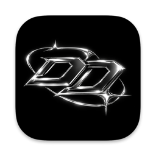
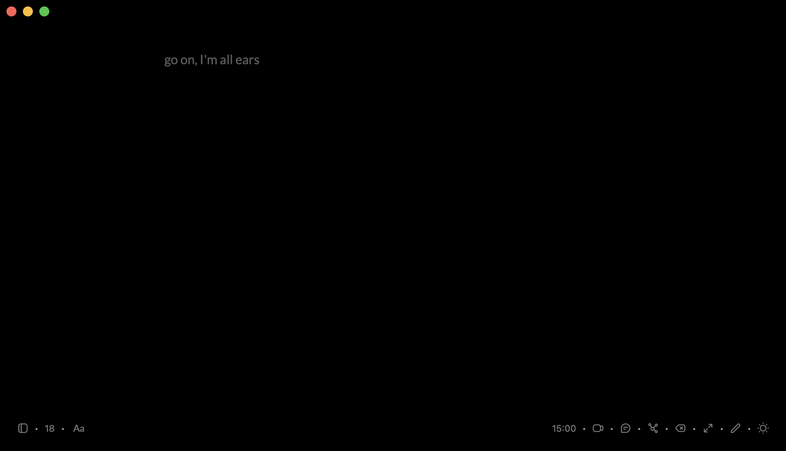
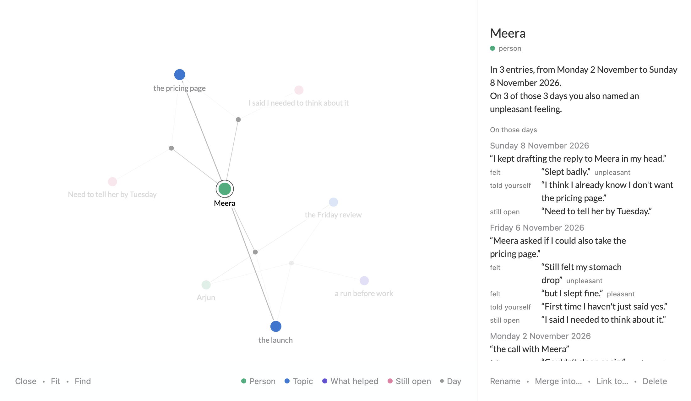
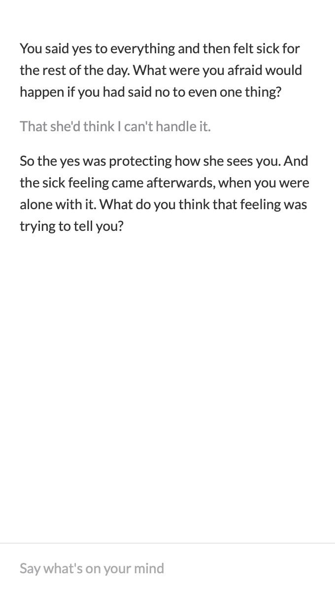
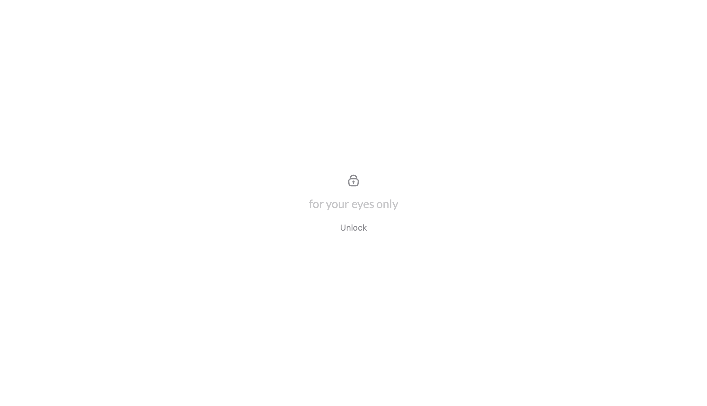

<p align="center">
  
</p>

# Dear Diary

An AI powered, local first personal diary for your Mac.

A blank page to write on, an AI you can talk the page through with, and a memory of what keeps coming up in your writing that you can see and correct. Everything is kept on your Mac as plain files.

Dear Diary is built on [freewrite](https://github.com/farzaa/freewrite) by Farza, and everything freewrite does is still here.



## What it does

- **The page.** freewrite's blank page, with its timer, fonts, video entries, backspace off and History. A new entry each day, saved as you type.
- **Talk.** Write first, then open a column beside the page and think it through with an AI that has read the entry. It asks more than it tells.
- **Memory.** The AI reads each entry once you have finished with it and keeps notes on the people, feelings, questions and decisions that keep coming up. Every note is tied to a line you wrote. If the AI quotes something that is not in your entry, the note is thrown away.
- **A map of that memory.** Thoughts are coloured dots and the days you wrote are small grey ones. Click a thought to read the lines behind it. Rename, merge, link or delete anything the AI got wrong, and your fixes win from then on.
- **Versions.** A copy of an entry every five minutes while it changes, so you can read an earlier one and bring it back.
- **A lock.** Dear Diary opens locked and asks for Touch ID or your Mac password. It locks again when your Mac sleeps and after a while in the background.
- **Your old entries.** If you used freewrite before, Settings can copy your entries across, videos included.

Talk, Memory and Versions are off until you turn them on in Settings. The lock is on from the start.

| Memory | Talk |
| --- | --- |
|  |  |

The pictures on this page are drawn by the app's own tests, with made-up entries.

## Your writing stays yours

- Entries are plain markdown files in a folder on your Mac. Memory is plain markdown and JSON beside them, and the folder opens as an Obsidian vault.
- With AI off, Dear Diary makes no network requests at all.
- You choose what the AI runs on:
  - **On this Mac**, a free open model through [Ollama](https://ollama.com). Nothing you write leaves the Mac.
  - **OpenAI**, **Claude**, or any service that speaks the OpenAI chat format, with your own API key. The entry you are talking about, or the entry being read for memory, is sent to that service.
- API keys are kept in the macOS Keychain and nowhere else.
- No accounts, no analytics, no cloud.
- The lock covers Dear Diary's windows. It does not encrypt the files, which are protected by your Mac's own login.



## Getting it

There is no download yet. For now you build it yourself.

1. You need macOS 14 or later and Xcode 16 or later.
2. Clone this repository and open `freewrite.xcodeproj`. (The project keeps freewrite's name so changes from freewrite stay easy to bring in. The app it builds is called Dear Diary.)
3. Under Signing & Capabilities, choose your own team for each of the three targets.
4. Press Run.

To put the app in your Applications folder instead, run this from the project folder once step 3 is done:

```bash
./scripts/install.sh
```

## Setting up the AI

Open Settings from the Dear Diary menu, or press ⌘ and comma, and turn AI on.

- **On this Mac.** Install [Ollama](https://ollama.com), download a model (for example `ollama pull llama3.2`), then choose "On this Mac". Dear Diary lists the models you have. A larger model writes better memory if your Mac has room for one.
- **OpenAI or Claude.** Paste your own API key and pick a model from the list. A ChatGPT or Claude subscription does not include this; it needs an API key.
- **Other.** Give the address of any service that speaks the OpenAI chat format.

## Where things are kept

Dear Diary is sandboxed, so its folder is inside its own container:

```text
~/Library/Containers/com.priyanshuratnakar.deardiary/Data/Documents/Freewrite/
  [id]-[date].md        your entries
  Videos/               video entries
  conversations/        what was said in Talk, one file per entry
  memory/               the AI's notes: profile.md, thoughts/, entries/, and your fixes
  versions/             earlier copies of entries
```

All of it is plain text you can read, edit or delete by hand.

## Where it stands

This is a personal project and it is early. It has about 500 automated tests. Running on this Mac through Ollama and the lock have been used for real. The OpenAI and Claude paths are covered by tests but have not yet been tried against the real services.

## Working on the code

- `docs/PRD.md` is the spec. `CLAUDE.md` (mirrored in `AGENTS.md`) explains how the code is put together, milestone by milestone. `docs/messages.md` lists every line the app can show.
- New code lives in its own folders under `freewrite/`: `AI`, `Memory`, `Talk`, `Map`, `Versions`, `Settings`, `Page` and `Lock`.
- Run the tests with `./scripts/test.sh`.

## Thanks

- [freewrite](https://github.com/farzaa/freewrite) by Farza, which this is a fork of.
- Icons from the free [Pikaicons](https://pikaicons.com) pack, with a few drawn to match.

## License

MIT, the same as freewrite. See `LICENSE`, which keeps freewrite's copyright notice. The icons' own notice is in `freewrite/Page/PikaIcons-LICENSE.txt`.
